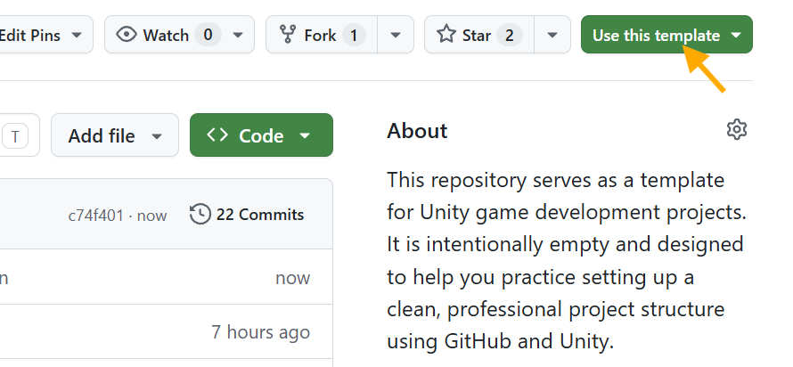
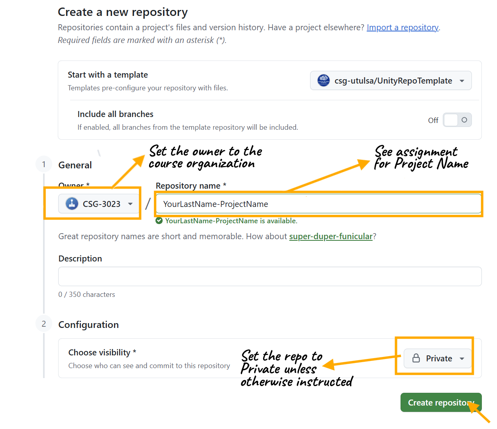

# CSG Repository Template

This repository is a reusable starting point for Computer Simulation & Gaming (CSG) Unity projects at the University of Tulsa. It provides a standardized repository structure, Git configuration files, automation scripts, and a Unity project setup package to help you organize your work and follow professional software development practices.

**This template is not a completed Unity project.** You will create your own GitHub repository from this template, create a Unity project inside that repository, and configure both environments before beginning your assignment.

By following these instructions, you will establish a project that supports:

- **Project organization:** A consistent structure for Unity assets, source code, documentation, and other project files.
- **Version control:** Git branches, commit conventions, and pull requests to manage and review changes.
- **Unity collaboration:** Git Large File Storage (LFS) and Unity SmartMerge configuration to help manage large assets and merge conflicts.
- **Automated setup:** Scripts and tools that configure your local development environment and establish a standardized Unity project structure.

Complete the setup instructions in order before beginning assignment work. Once your repository and Unity project are configured, follow the assignment-specific instructions for developing, documenting, and submitting your work.

---

## 📁 Repository Structure Overview
The **repository root** contains project-level documentation, configuration files, automation scripts, and the Unity project setup package. Your Unity project will live in its own subfolder within the repository.

>[!NOTE]
>**The Unity project folder will not exist when you first create your repository.** You will create it in the repository root during the setup process. Until then, the repository will contain only the files and folders provided by the template.
>

The repository will contain the following:
- **Repository root:** The README, Git configuration files, automation scripts, setup packages, and other project-level resources.
- **`docs/`:** Supporting documentation, planning materials, research, technical notes, references, and other development resources.
- **`docs/imgs/`:** Screenshots, diagrams, and other images used in documentation and the project wiki.
- **`LastName-ProjectName-Unity/`:** Your Unity project, including its `Assets`, `Packages`, and `ProjectSettings` folders.

Additional documentation that is not published on the project wiki can also be stored in `docs/`, including design notes, research, meeting notes, and supplementary assignment materials.

---

## 🛠️ Setup Instructions

Follow these steps **in order** before starting the assignment.

---
### 1. Create Your Repository from the Template
1. Open the CSG Repository Template on GitHub.
2. Click **Use this template**, then select **Create a new repository**.



3. Under **Owner**, select the correct **GitHub organization for your course** _(i.e., CSG-3023, CSG-3813, etc.) 
4. Enter your repository name using the following format:
    - **`LastName-ProjectName`**
    - Replace `LastName` with your last name and `ProjectName` with the assignment or project name.
    -  **Example:** If your last name is Dent and the project is Sandbox, name your repository: `Dent-Sandbox`

5. Choose the repository visibility specified by your instructor.
6. Click **Create repository**.
   


---
### 2. Create Your Local Project Folder

Before creating the Unity project, download your new repository to your computer by cloning it.

1. Open your newly created GitHub repository.
2. Click **Code** and copy the repository's HTTPS URL.
3. Open GitHub Desktop, your IDE, or Git Bash and clone the repository to your preferred development folder.
4. Confirm that the cloned repository contains the template files, including the **`README.md`**, **`automation/`** folder, and **`CSG-ProjectSetup.unitypackage`**.

Your local repository folder should match your GitHub repository name.

---

### 3. Create the Setup Branch

The project uses a protected Git workflow. The `main` branch is reserved for stable, approved project changes and cannot be pushed to directly.

All development must take place on a **working branch**. Changes are submitted to `main` through a **Pull Request (PR)** for review and merging.

Immediately after cloning the repository, create a setup branch before making any project changes.

#### Option 1: Using GitHub Desktop

1. Open the repository in GitHub Desktop.
2. Click the current branch name in the top toolbar.
3. Select **New Branch**.
4. Enter `setup/unity-project` as the branch name.
5. Click **Create Branch**.

#### Option 2: Using Git Bash

1. Open Git Bash in the repository folder.
2. Run the following command:

```bash
git switch -c setup/unity-project
```

This command creates a new branch named `setup/unity-project` from the currently checked-out branch (`main`) and switches your working copy to it.

---

### 4. Create the Unity Project

1. Open **Unity Hub**.
2. Click **+ New Project**.
3. Choose the **Core Universal 3D** template (*unless otherwise instructed*).
4. Set the **location** to this repository's root folder.
5. Name the Unity project folder `ProjectName-Unity`.

> [!NOTE]
> Name your GitHub repository using the format **`LastName-ProjectName`**.
>
> The Unity project folder should use the same name with **`-Unity`** added to the end: **`LastName-ProjectName-Unity`**.
>
> For example, a GitHub repository named **`Dent-Sandbox`** would contain a Unity project named **`Dent-Sandbox-Unity`**.

---

### 4. Configure Ignore & Attribute Rules
We use a layered configuration to manage files. You must manually "activate" these rules by renaming files.

#### A. Activate the Root Attributes (LFS & SmartMerge)
The repository root contains a file named `Unity.gitattributes`. This contains the rules for Large File Storage (LFS) and the SmartMerge logic you just configured.
1.  Locate **`Unity.gitattributes`** in the repository root.
2.  RENAME it to **`.gitattributes`**.
    
> [!NOTE]
> This file must stay in the root folder to work.
> It is named `Unity.gitattributes` in the template because GitHub restricts active LFS triggers on template repositories; renaming it "activates" the tracking for your project.
> 

#### B. The Unity Project Ignore Rules
1.  Locate the **`Unity.gitignore`** file (also in the root folder).
2.  **MOVE** this file into your `ProjectName-Unity` folder.
3.  **RENAME** it from `Unity.gitignore` to **`.gitignore`**.
    
> [!WARNING]
> This file must live **inside the Unity project folder**, not the root.
> It handles the engine-specific junk like the `Library/` folder, which can be several gigabytes of generated data.

> [!NOTE]
> Inside the root folder, there is another`.gitignore` file. **Leave this here.**
> It ignores IDE-specific folders (VS Code/Visual Studio), system logs, and build outputs that happen outside of the Unity folder.
> 

---

### 6. Run the Automation Script
This repository template includes a setup script designed to automate your environment. It handles three critical tasks:
- **Git Automation (Commit Rules):** Installs a linter that ensures your commit messages follow the project's categorization (e.g., `feat:`, `fix:`, `refactor:`).
- **Branch Protection & Naming (Pre-Push):** Installs a "gatekeeper" that prevents you from pushing to the wrong branch (`main`/`release`) and ensures your branch name follows the `type/description` format.
- **Git LFS Initialization:** Registers local Git LFS filters and hooks so large binary assets (textures, 3D models, audio) are tracked properly across all IDEs and Git tools (including JetBrains Rider and VS Code).
- **Unity YAML Merge:** Configures Unity's "SmartMerge" tool on your machine to automatically resolve conflicts in Scenes and Prefabs.

#### A. Open a Terminal    

1. **Open** Git Bash
2. Use the **`cd`** command to change to the repo directory 

Example:
```bash
cd D/Students/YourName/CSGXXX/LastName-ProjectName
```
> [!NOTE]
> If you set up or cloned this repository using an **IDE** (Rider, VS Code, etc.),  
> you do **not** need to open Git Bash separately.
> You can instead:
> 1. Open the **Terminal inside your IDE**
> 2. Ensure the terminal shell is set to **Git Bash**
> 3. The terminal will already be **pointing at your project directory**
> 
> In this case, you can skip the `cd` step and run the setup command directly.


#### B. Run the Setup Script

1. **Run** the setup script
```bash
./automation/setup-unity-repo.sh
```
2.  Follow the Prompts:
    -   **Drive Letter:** Type the letter where Unity is installed (usually `C`) and hit Enter.
    -   **Unity Version:** Type your exact Unity version (e.g., `6000.3.6f1`). You can find this in the Unity Hub under the "Installs" tab.

#### What to look for:
- The script will display `✅ SUCCESS` for **Git Automation**, **Git LFS**, and **Unity YAML Merge**.
- A final verification check will run at the end. If it verifies both SmartMerge and Git LFS, your setup is complete.

> [!IMPORTANT]
> **This setup is LOCAL to your computer.** Git hooks and Unity SmartMerge settings are stored in the hidden `.git` folder, which is not synced to GitHub for security reasons.
> 
> **You MUST run the automation script every time you:**
> -   Clone the project onto a new computer (e.g., switching from a lab PC to a laptop).
> -   Re-clone the project after deleting your local folder.
> -   Update Unity to a newer version (to ensure the SmartMerge path remains valid).
> -   
> If you don't run the script, your branch/commit rules won't work, and your Unity Scenes will likely break during merges!
>

---

### 7. Commit Initial Repository Setup

Before moving on to the Unity project configuration, save your initial repository setup changes in a Git commit.

#### A. Stage Your Changes

From the repository root, run:

```bash
git add .
```

This stages your changes so they can be included in a commit.

#### B. Commit Your Changes
Run the following command:

```bash
git commit -m "configured: initial project setup"
```

This saves your staged changes in your local Git history.

> [!IMPORTANT]
>  **All commit messages must follow the required commit message standard.** Refer to the project wiki's **Commit Naming Convention** for formatting rules and examples.

---

### 8. Import the CSG Project Setup Package

Instead of manually installing the hierarchy folder package and configuring the project yourself, this repository includes **`CSG-ProjectSetup.unitypackage`**. This package contains the CSG project setup tools used to standardize your Unity project.

#### A. Import the Package

1. Open your Unity project in the Unity Editor.
2. In the **Project** window, locate the `Assets` folder.
3. Right-click the `Assets` folder.
4. Select **Import Package → Custom Package...**.
5. Navigate to the **root of your repository** and select **`CSG-ProjectSetup.unitypackage`**.
6. Review the import dialog and click **Import**.

#### B. Run the Full Setup

After the package has finished importing:
1. Locate the Unity Editor's top menu bar.
2. Select **Tools → CSG → Setup → Run Full Setup**.
3. Allow the setup process to finish and review any messages in the Console.

The setup tools automate the following tasks:
- **Standardized Project Structure:** Creates the predefined folder structure under `Assets` to help keep project files organized.
- **Player Settings:** Configures the designated Player Settings, including the company name, application icon, and splash screen.
- **Default Packages:** Installs the default Unity packages configured by the setup tool through Unity Package Manager.
- **Hierarchy Folders:** Creates color-coded hierarchy folders in the sample scene using the Simple Unity Hierarchy Folder package.

> [!IMPORTANT]\
> **Organize the Sample Scene Hierarchy**
>
> The hierarchy folders are created in the provided **sample scene**. They are intended to organize the GameObjects in that scene; they do not automatically organize GameObjects in every scene in your project.
>
> After running the setup:
>
> - Review the newly created hierarchy folders in the Hierarchy window.
> - Move existing GameObjects into the appropriate folders.
> - Keep related GameObjects grouped together.
> - Use the provided folders when adding new GameObjects to the scene.
>
> For example, place player characters and NPCs under `Actors`, environmental objects under `Environment`, lights under `Lights`, and user interface objects under `UI`.
>
> **Do not leave existing GameObjects scattered at the root of the Hierarchy when an appropriate folder is available.** A clean hierarchy makes your scene easier to navigate, debug, and maintain.

> [!NOTE]\
> The setup package provides a consistent starting point, but it does not replace the assignment instructions. Follow any additional requirements specified for the assignment.

---

### 9. Verify Your Setup

Before committing your initial setup work, verify that each step has been completed successfully.

- The Unity project opens correctly.
- The root `.gitattributes` file is configured.
- The Unity project's `.gitignore` is in the correct folder.
- The automation script completed successfully.
- Git LFS and Unity SmartMerge are configured.
- You created and switched to the `init/setup` branch.
- `CSG-ProjectSetup.unitypackage` was imported successfully.
- `Tools → CSG → Setup → Run Full Setup` completed successfully.
- The sample scene hierarchy is organized into the appropriate folders.

Once everything is verified, commit and push your setup work before beginning the assignment.

---

### 10. Commit and Push Your Setup Work

After completing and verifying the repository and Unity setup, save your changes in Git and push your branch to GitHub. You will then open a pull request (PR) to merge your setup work into `main`.

> [!NOTE]
> The steps below use **Git Bash** commands. You can also complete the same workflow using **GitHub Desktop**.

#### A. Review and Commit Your Changes

From the repository root, run:

```
git status
```

Review the listed changes to confirm that the correct files are included. Stage the files you want to commit:

```
git add .
```

Commit your staged changes using the required commit-message format:

```
git commit -m "configured: Unity project setup"
```

> [!IMPORTANT]
>  **All commit messages must follow the required commit message standard.** Refer to the project wiki's **Commit Naming Convention** for formatting rules and examples.

#### B. Push Your Branch to GitHub

Push your `setup/unity-project` branch to the remote repository:

```
git push -u origin setup/unity-project
```

This pushes your local branch to GitHub and establishes an upstream tracking branch. 

For subsequent pushes from this branch, you can simply use:
```
git push
```

#### C. Open a Pull Request
Open your repository on GitHub and create a Pull Request:
1. Navigate to the **Pull Requests** tab.
2. Click **New Pull Request**.
3. Set the base branch to main and the compare branch to `setup/unity-project`.
4. Review the changes included in the Pull Request.
5. Click **Create Pull Request**.
   
Once your Pull Request has been reviewed and merged, your initial repository and Unity project setup will be part of main.

> [!IMPORTANT]
> **Do not attempt to push directly to `main`**. All changes must be committed to your **working branch** and merged through a **Pull Request**.


---

## ✅ Ready to Begin

Your repository and Unity project are now configured and ready for assignment work!

For future development, follow this Git workflow:

- **Start with `main`:** Pull the latest changes from GitHub before starting new work.
- **Create a working branch:** Use the required branch naming convention for each new feature, fix, or task.
- **Commit and push regularly:** Save your progress using the required commit-message format.
- **Submit a Pull Request:** Once your work is complete and ready for review, submit a PR to merge it into `main`.

You do not need to create a new branch for every commit. Continue using the same branch for related work until it is ready to be merged.

Refer to the project wiki's **Branch Naming Convention** and **Commit Naming Convention** for formatting rules and examples.

**Get set up, stay organized, and get creative!**
